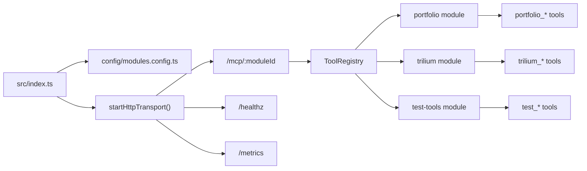
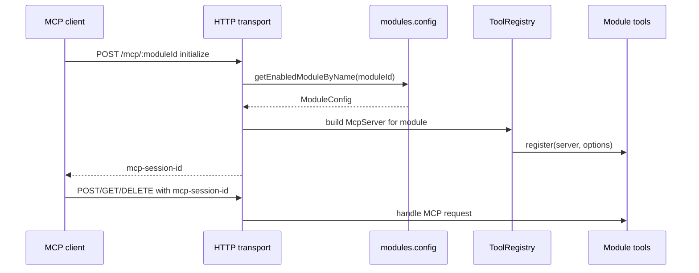
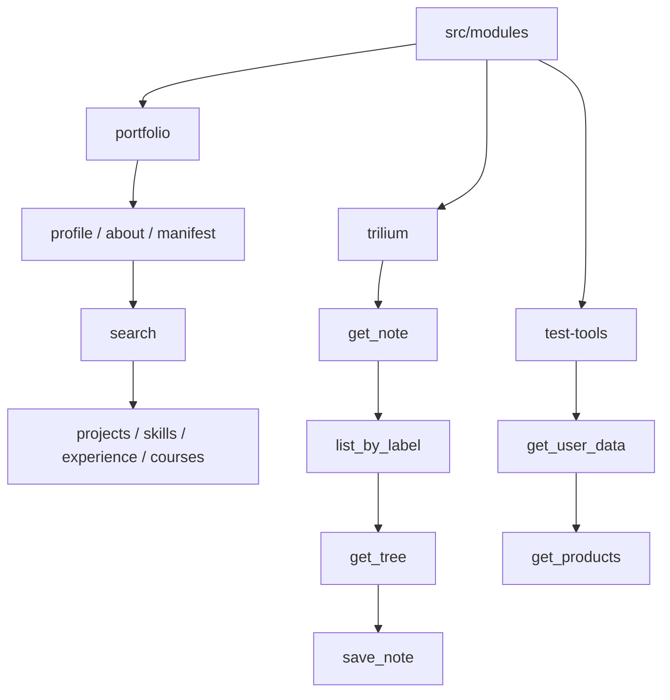

# Unified Agent Context System (MCP)

    

Unified Agent Context System to dedykowana warstwa kontekstowa oparta o [Model Context Protocol](https://modelcontextprotocol.io/). Łączy portfolio, notatki, narzędzia diagnostyczne i obserwowalność w jeden serwer MCP, który może zasilać agentów AI uporządkowanymi danymi z kilku domen.

## Spis Treści

- [Możliwości](#możliwości)
- [Rola Narzędzia](#rola-narzędzia)
- [Środowiska](#środowiska)
- [Architektura](#architektura)
- [Transporty](#transporty)
- [Moduły i narzędzia](#moduły-i-narzędzia)
- [Konfiguracja](#konfiguracja)
- [Obsługa Operacyjna](#obsługa-operacyjna)
- [Observability](#observability)
- [Docker](#docker)
- [Integracja z klientami MCP](#integracja-z-klientami-mcp)
- [Treść portfolio](#treść-portfolio)
- [Dodawanie modułu](#dodawanie-modułu)
- [Licencja](#licencja)

## Możliwości

| Obszar | Rola w systemie |
| --- | --- |
| Warstwa MCP | Jeden punkt dostępu do narzędzi kontekstowych dla agentów AI. |
| Moduły domenowe | Osobne moduły dla portfolio, Trilium i narzędzi diagnostycznych. |
| Transport HTTP | Streamable HTTP z sesjami MCP pod `/mcp/<moduleId>`. |
| Bezpieczeństwo | Bearer token wymagany dla ścieżek MCP. |
| Observability | Health checks, request IDs i metryki Prometheus dla pracy serwera. |
| Portfolio | Strukturalny dostęp do profilu, projektów, umiejętności, doświadczenia i kursów. |
| Trilium | Dostęp do notatek, drzewa wiedzy i zapisu treści przez ETAPI. |
| Środowiska | Podział pracy między środowisko produkcyjne dla portfolio i homelab dla Trilium. |
| Test tools | Moduł kontrolny do diagnostyki rejestracji narzędzi. |

## Rola Narzędzia

System pełni rolę dedykowanej warstwy kontekstowej dla agentów AI, ale pozostaje zorganizowany jak pełnoprawny serwer produkcyjny: ma moduły, izolację transportu, metryki, health checks i jawne kontrakty narzędzi. Zamiast trzymać kontekst w jednym dużym promptcie, wystawia go jako zestaw narzędzi MCP z czytelnymi namespace'ami.

Najważniejsze scenariusze:

- prezentowanie danych portfolio przez narzędzia `portfolio_*`,
- wyszukiwanie i filtrowanie treści z lokalnego korpusu Markdown,
- pobieranie i zapisywanie notatek Trilium przez `trilium_*`,
- wystawienie modułów przez HTTP dla agentów lub środowisk zdalnych,
- monitorowanie działania przez `/healthz` i `/metrics`.

Adres modułu w transporcie HTTP ma postać:

```text
http://127.0.0.1:3333/mcp/<moduleId>
```

Przykłady: `/mcp/portfolio`, `/mcp/trilium`, `/mcp/test-tools`.

## Środowiska

Serwer jest projektowany jako jedna warstwa MCP działająca w dwóch kontekstach operacyjnych:

| Środowisko | Moduł | Rola |
| --- | --- | --- |
| Produkcyjne | `portfolio` | Publiczna warstwa danych portfolio, projektów, umiejętności, doświadczenia i kursów. |
| Homelab | `trilium` | Integracja z prywatną bazą wiedzy Trilium przez ETAPI. |

Moduł `trilium` jest rozwijany na branchu `feat/trilium-integration`.

## Architektura



Główne warstwy:

| Warstwa | Lokalizacja | Odpowiedzialność |
| --- | --- | --- |
| Core | `src/core/` | Tworzenie `McpServer`, typy modułów, rejestracja narzędzi przez `ToolRegistry`. |
| Transporty | `src/transports/` | HTTP jako domyślna ścieżka uruchomienia oraz alternatywny transport stdio. |
| Moduły | `src/modules/` | Domenowe zestawy narzędzi MCP. |
| Observability | `src/observability/` | Health checks, metryki Prometheus, instrumentacja narzędzi. |
| Config | `config/modules.config.ts` | Flagi `ENABLE_MODULE_*`, namespace narzędzi i konfiguracja modułów. |

### Przepływ Sesji HTTP



W HTTP `moduleId` pochodzi ze ścieżki URL, np. `/mcp/portfolio`. Namespace narzędzi jest osobną wartością konfiguracyjną, np. `PORTFOLIO_NAMESPACE=portfolio`, i wpływa na nazwy narzędzi typu `portfolio_get_profile`.

## Transporty

| Transport | Status | Plik | Zastosowanie |
| --- | --- | --- | --- |
| Streamable HTTP | Domyślny | `src/transports/http.ts` | Serwer dla agentów zdalnych, VPS, reverse proxy i klientów MCP obsługujących HTTP. |
| stdio | Alternatywny | `src/transports/stdio.ts` | Klienci spawnujący proces Node i komunikujący się przez stdin/stdout. |

### HTTP

HTTP startuje z `src/index.ts` przez `startHttpTransport(buildMcpServerForModule, { port, host })`.

Wymagania:

- `MCP_INTERNAL_TOKEN` musi być ustawiony i niepusty.
- Każde żądanie do `/mcp/<moduleId>` musi mieć nagłówek `Authorization: Bearer <token>`.
- `/healthz` i `/metrics` nie wymagają Bearer tokena.

Domyślne wartości:

| Zmienna | Domyślnie | Znaczenie |
| --- | --- | --- |
| `MCP_HOST` | `127.0.0.1` | Host bindowania HTTP. |
| `MCP_PORT` | `3333` | Port HTTP. |
| `HEALTH_PATH` | `/healthz` | Endpoint health check. |
| `METRICS_PATH` | `/metrics` | Endpoint metryk Prometheus. |

### stdio

`startStdioTransport(server)` istnieje w `src/transports/stdio.ts`, ale nie jest podłączony w domyślnym `src/index.ts`. Żeby użyć stdio, trzeba przygotować osobny entry point albo ręcznie przełączyć `index.ts` z HTTP na stdio.

Minimalny schemat:

```typescript
const server = createMcpServer();
const registry = new ToolRegistry(server);
await registry.loadSingleModule(moduleConfig);
await startStdioTransport(server);
```

## Moduły i narzędzia



### Portfolio

Moduł `portfolio` obsługuje środowisko produkcyjne: udostępnia publiczne dane portfolio z plików Markdown i `manifest.json`. Treść jest czytana z `PORTFOLIO_CONTENT_ROOT`, a ścieżki są chronione przed path traversal.

Domyślny namespace narzędzi: `portfolio`.

| Narzędzie | Opis |
| --- | --- |
| `{ns}_get_profile` | Profil publiczny. |
| `{ns}_get_about` | Sekcja "O mnie". |
| `{ns}_get_manifest` | Manifest treści portfolio. |
| `{ns}_search` | Wyszukiwanie po korpusie. |
| `{ns}_projects_query`, `{ns}_projects_list`, `{ns}_projects_get`, `{ns}_projects_tags` | Projekty. |
| `{ns}_skills_query`, `{ns}_skills_list`, `{ns}_skills_get`, `{ns}_skills_tags`, `{ns}_skills_categories` | Umiejętności. |
| `{ns}_experience_query`, `{ns}_experience_list`, `{ns}_experience_get`, `{ns}_experience_tags` | Doświadczenie. |
| `{ns}_courses_query`, `{ns}_courses_list`, `{ns}_courses_get`, `{ns}_courses_tags`, `{ns}_courses_categories`, `{ns}_courses_platforms` | Kursy. |

### Trilium

Moduł `trilium` obsługuje środowisko homelab: integruje MCP z Trilium Notes przez ETAPI. Wymaga `TRILIUM_BASE_URL` i `TRILIUM_API_TOKEN`. Kod modułu znajduje się na branchu `feat/trilium-integration`.

Domyślny namespace narzędzi: `trilium`.

| Narzędzie | Tryb | Opis |
| --- | --- | --- |
| `{ns}_get_note` | Read | Pobiera metadane notatki, opcjonalnie także treść. |
| `{ns}_list_by_label` | Read | Wyszukuje notatki po labelce `#label` albo `#label=value`. |
| `{ns}_get_tree` | Read | Buduje drzewo notatek od wskazanego korzenia. |
| `{ns}_save_note` | Write | Tworzy nową notatkę albo aktualizuje tytuł/treść istniejącej. |

Ważne: chronione notatki Trilium są obsługiwane jako błąd narzędzia bez ujawniania treści.

### test-tools

Moduł kontrolny do sprawdzania działania rejestracji narzędzi i odpowiedzi MCP.

Domyślny namespace narzędzi: `test`.

| Narzędzie | Opis |
| --- | --- |
| `{ns}_get_user_data` | Zwraca przykładowe dane użytkownika. |
| `{ns}_get_products` | Zwraca przykładowe produkty. |

W konfiguracji publicznej lub produkcyjnej zwykle warto go wyłączyć:

```bash
ENABLE_MODULE_TEST_TOOLS=false
```

## Konfiguracja

Konfiguracja modułów znajduje się w `config/modules.config.ts`, a przykładowe zmienne w `.env.example`.

### Zmienne Wspólne

| Zmienna | Wymagana | Opis |
| --- | --- | --- |
| `MCP_HOST` | Nie | Host HTTP, domyślnie `127.0.0.1`. |
| `MCP_PORT` | Nie | Port HTTP, domyślnie `3333`. |
| `MCP_INTERNAL_TOKEN` | Tak dla HTTP | Bearer token wymagany dla `/mcp/<moduleId>`. |
| `HEALTH_ENABLED` | Nie | `false` wyłącza health endpoint. |
| `HEALTH_PATH` | Nie | Domyślnie `/healthz`. |
| `METRICS_ENABLED` | Nie | `false` wyłącza metryki. |
| `METRICS_PATH` | Nie | Domyślnie `/metrics`. |

### Portfolio

| Zmienna | Domyślnie | Opis |
| --- | --- | --- |
| `ENABLE_MODULE_PORTFOLIO` | Włączony, jeśli nie `false` | Flaga modułu. |
| `PORTFOLIO_NAMESPACE` | `portfolio` | Prefix nazw narzędzi. |
| `PORTFOLIO_CONTENT_ROOT` | `src/modules/portfolio/content` | Katalog treści. |
| `PORTFOLIO_CORPUS_VERSION` | `1.0.0` | Wersja korpusu zwracana w danych modułu. |

### Trilium

| Zmienna | Domyślnie | Opis |
| --- | --- | --- |
| `ENABLE_MODULE_TRILIUM` | Włączony, jeśli nie `false` | Flaga modułu. W `.env.example` ustawiona na `false`. |
| `TRILIUM_NAMESPACE` | `trilium` | Prefix nazw narzędzi. |
| `TRILIUM_BASE_URL` | Brak | Bazowy URL Trilium ETAPI. |
| `TRILIUM_API_TOKEN` | Brak | Token ETAPI. |

Jeśli Trilium jest włączony bez `TRILIUM_BASE_URL` i `TRILIUM_API_TOKEN`, `src/index.ts` przerwie start procesu.

### test-tools

| Zmienna | Domyślnie | Opis |
| --- | --- | --- |
| `ENABLE_MODULE_TEST_TOOLS` | Włączony, jeśli nie `false` | Flaga modułu demonstracyjnego. |
| `TEST_TOOLS_NAMESPACE` | `test` | Prefix nazw narzędzi. |

## Obsługa Operacyjna

| Komenda | Opis |
| --- | --- |
| `npm run dev` | Start developerski przez `tsx watch src/index.ts`. |
| `npm run build` | Kompilacja TypeScript i kopiowanie contentu portfolio do `dist`. |
| `npm start` | Start produkcyjny z `dist/src/index.js`. |
| `npm run typecheck` | Sprawdzenie typów bez generowania plików. |

Build uruchamia `tsc` oraz `scripts/copy-portfolio-content.mjs`, żeby content portfolio był dostępny po kompilacji.

## Observability

Endpointy observability są rejestrowane tylko przez transport HTTP.

### Health

`GET /healthz` zwraca:

```json
{
  "status": "ok",
  "checks": []
}
```

Status globalny:

- `ok` - wszystkie checki włączonych modułów są poprawne.
- `degraded` - co najmniej jeden check zwrócił błąd.

Aktualne checki:

| Moduł | Check | Znaczenie |
| --- | --- | --- |
| `portfolio` | `portfolio_content_root` | Czy katalog contentu istnieje i jest czytelny. |
| `trilium` | `trilium_etapi` | Czy konfiguracja ETAPI działa i Trilium odpowiada. |

### Metryki Prometheus

`GET /metrics` zwraca metryki z `prom-client`.

| Metryka | Typ | Etykiety |
| --- | --- | --- |
| `mcp_http_requests_total` | Counter | `method`, `status_class`, `module` |
| `mcp_auth_failures_total` | Counter | `reason` |
| `mcp_protocol_errors_total` | Counter | `module`, `code` |
| `mcp_sessions_active` | Gauge | `module` |
| `mcp_sessions_opened_total` | Counter | `module` |
| `mcp_sessions_closed_total` | Counter | `module` |
| `mcp_tool_invocations_total` | Counter | `module`, `tool`, `result` |
| `mcp_tool_duration_seconds` | Histogram | `module`, `tool` |

Każde żądanie HTTP dostaje `requestId` z nagłówka `x-request-id` albo z `randomUUID()`.

## Docker

Projekt zawiera `Dockerfile` i `docker-compose.yml`.

```bash
docker compose up --build
```

W `docker-compose.yml` kontener wystawia port `8090`, dlatego w `.env` dla tego wariantu ustaw:

```bash
MCP_HOST=0.0.0.0
MCP_PORT=8090
MCP_INTERNAL_TOKEN=production-token
```

Przykładowy endpoint po starcie:

```text
http://127.0.0.1:8090/mcp/portfolio
```

## Integracja z klientami MCP

### HTTP

Dla klientów obsługujących Streamable HTTP użyj adresu modułu:

```text
http://<host>:<port>/mcp/<moduleId>
```

Do żądań MCP dodaj nagłówek:

```text
Authorization: Bearer <MCP_INTERNAL_TOKEN>
```

### Cursor i stdio

Domyślny entry point uruchamia HTTP, nie stdio. Jeśli klient wymaga konfiguracji `command` + `args`, przygotuj wariant stdio, który wywołuje `startStdioTransport(server)`.

Po zbudowaniu projektu typowa ścieżka entry pointu to:

```text
dist/src/index.js
```

## Treść portfolio

Pliki portfolio znajdują się w:

```text
src/modules/portfolio/content/
```

Po buildzie content jest kopiowany do:

```text
dist/src/modules/portfolio/content/
```

Przykładowy front matter:

```markdown
---
project_name: Mój projekt
project_category: Web Development
tech_stack: Next.js, TypeScript
---

Opis projektu...
```

## Dodawanie modułu

1. Utwórz katalog `src/modules/<nazwa>/`.
2. Dodaj `index.ts` z eksportem `register(server, options)`.
3. Opcjonalnie dodaj `checkHealth(config)`.
4. Dodaj wpis do `config/modules.config.ts`.
5. Ustal `ENABLE_MODULE_<NAZWA>` i namespace w `.env.example`.
6. Rejestruj narzędzia z nazwą opartą o namespace, np. `${namespace}_my_tool`.

HTTP używa `name` z konfiguracji jako `moduleId` w ścieżce `/mcp/<moduleId>`. Namespace służy do nazw narzędzi i może być inny niż `moduleId`.

## Licencja

ISC
